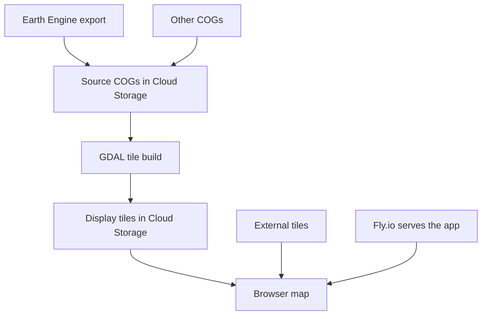

# Nature Watch — technical blueprint

Nature Watch helps people explore environmental pressures and natural landscapes. The current app focuses on Africa, with a longer-term ambition of global coverage and ecological assessment.

This document describes the working system and agreed direction. Detailed file paths, inspection evidence, run notes and proposals are in [Technical reference](blueprint-notes.md).

How to read the published map: [Using the map](using-the-map.md). Sources and limits of each layer: [Data notes](data.md). Commands and branches: the [app README](../README.md).

*Updated 22 October 2026. `nature-watch-bucket` access was checked again that day and made private. The rest of the system description is still the 16 October inspection. The Sooty Earth release rule and roadmap were accepted on 20 October.*

## 1. How the system fits together

| Repository | Responsibility |
| --- | --- |
| `marynvdl/naturewatch-app` | Vue / Vuetify / Mapbox interface, layer catalogue, FastAPI server and Fly.io deployment |
| `marynvdl/naturewatch-analysis` | Earth Engine exports and GDAL tile production |

The analysis pipeline publishes data. The app reads published tiles; it does not run the analysis or call the analysis repository.

This export-to-tile automation is implemented for fire. Built, bare ground and crops retain older VM-based tile workflows. Tree loss and 2020 tree height are served externally by Global Forest Watch; dams use a Mapbox tileset. Tree height tiles cover the globe. The other published layers keep their existing coverage.

The connection between data and app is defined by **published object paths** and the **layer catalogue** at `frontend/naturewatch/src/catalog/layers.json`.

The `sources`, `places`, and `facts` tables are in Supabase, and the FastAPI service is unchanged.

## 2. Storage and access

| Bucket | Contents | Access |
| --- | --- | --- |
| `gs://nature-watch-bucket` | Source rasters, including `COGS/fire/<year>/` and the cropland seed and sprout prefixes | Private since 22 October 2026. Public access prevention is enforced. `gee-1-238@nature-watch-387210.iam.gserviceaccount.com` has `roles/storage.objectAdmin`. |
| `gs://nature-watch-tiles` | Display tiles, including `fire/<year>/{z}/{x}/{y}.png` | Public read; keeping map tiles public is agreed |

Both buckets belong to GCP project `nature-watch-387210`. The inspected machine’s default project was `science-428407`; confirm the intended project before cloud operations. The Earth Engine billing project remains unresolved.

## 3. Behavior that must remain explicit

- **Dates:** when a layer lacks the selected year, the app uses its latest available earlier year. If every listed year is later, the layer is not requested, except a layer marked static, which stays visible on its latest listed year. Tree height is a static 2020 layer. A timeline selection does not guarantee that every layer represents that year. Crops currently list 2015 and 2019.
- **Fire processing:** FIRMS `T21` detections are counted in 14-day windows on a grid using scale 1,000 m in `EPSG:3857`, then exported as 30 m COGs in `EPSG:4326` across 25 Africa blocks.
- **Fire display:** GDAL resamples to the 1 km display grid, applies baked colors and creates XYZ PNG tiles for zooms 0–9. Zero is transparent; the app uses nearest-neighbor rendering.
- **Fire compatibility:** the current export uses 27 windows and includes about 13 days of the following January. These quirks were intentionally retained for comparability with previous years. The legend still says 26 and needs reconciliation. Do not change the method for one year without addressing comparability.
- **Layer status:** placeholder URLs and “Coming soon” labels are not evidence of published data. The detailed reference lists current inconsistencies.

## 4. Development and release

For the app:

1. Create feature or bugfix branches from `develop` and merge back through a pull request.
2. Release through a pull request from `develop` to `main`.
3. The recent release practice adds a version tag on `main`, then syncs the release merge back into `develop` through a pull request. Latest recorded release: `v1.1.3`.

The app workflow runs tests and a Docker build on every push. Pushes to `develop` deploy Fly app `naturewatch`; pushes to `main` deploy `naturewatch-demo`.

Sooty Earth is built on `develop`. Do not open a pull request from `develop` into `main` until that public-site change is explicitly requested. naturewatch.space stays on the current release until then. The step-by-step plan is the [Sooty Earth roadmap](sooty-earth-roadmap.md).

In the analysis repository, fire export and tile production are manually triggered, apart from the tile dry run on relevant pull requests. Built, bare-ground and crop workflows trigger on relevant pushes and can create VMs. Those workflows do not automatically stop the VMs.

Inspect workflow triggers before pushing. Obtain authorization before billable processing or production deployment. After an authorized long Earth Engine submission, record its identifiers, outputs and monitoring instructions rather than keeping the chat waiting.

## 5. Agreed direction, not yet implemented

The cropland discussion established the following direction:

- Keep Google Cloud Storage and retain numerical source rasters separately from display products.
- Separate **visual aggregation** from **analytical statistics**: maximum overviews preserve sparse features visually; area and percentage come from original class-pixel counts.
- Aim for class-value display tiles with client-side coloring. Current fire tiles are already colored and do not implement this design.
- Prebuild a bounded range of low zooms; choose the higher-zoom approach later.
- Precompute statistics for known spaces when publishing a layer year, then serve those results for catalogue comparisons.
- Consider a 1 km or H3 grid for flexible queries later. Official figures for small spaces should come from the source raster. On-demand tiling is a possible later delivery option.

Accepted for the first Sooty Earth release, and not yet built:

- The first layer year is GLAD annual cropland 2024, clipped to South Africa. It is a new catalog layer, separate from the 2015 and 2019 cropland snapshots.
- Cropland facts for the pilot places. The `facts` table stays empty until that step.
- The interface is rebranded to Sooty Earth on `develop` before any production release. The sequence and done-when for each step are in the [roadmap](sooty-earth-roadmap.md).

The first places are terrestrial protected areas in South Africa with calculated `area_km2` of at least 10. Source rasters and tiles stay in Cloud Storage.

## 6. Decisions still needed

- Source rasters in `nature-watch-bucket` are private as of 22 October 2026. Map tiles stay public. Still to confirm on the next fire-tile run: the GitHub `GCP_SA_KEY` is `gee-1-238@nature-watch-387210.iam.gserviceaccount.com`, which can read the private bucket. Its write access to `nature-watch-tiles` was not rechecked.
- How close-zoom cropland will be served.
- Whether public map geometries are permitted under the WDPCA licence, or only stored statistics.
- The Earth Engine billing project and the continuing role of `naturewatch-gee`, which was not inspected.
- The production domain, and when the GitHub repositories are renamed. Bucket names, Fly app names, and the GCP project stay as they are through that rename.

Other proposals, known inconsistencies and the exact inspected commits remain in [Technical reference](blueprint-notes.md). Update this blueprint when the architecture or an accepted decision changes; keep experiments and longer discussions in Notion.
