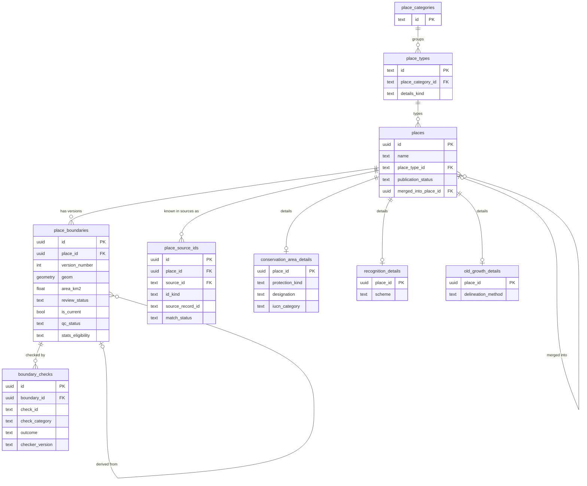
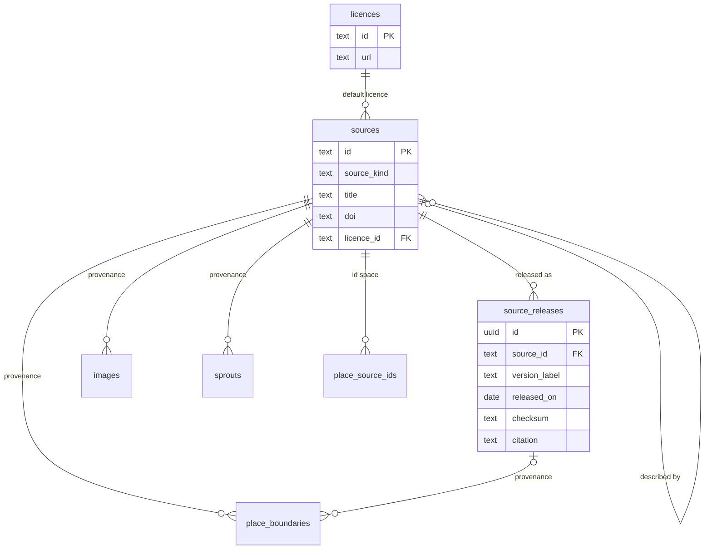
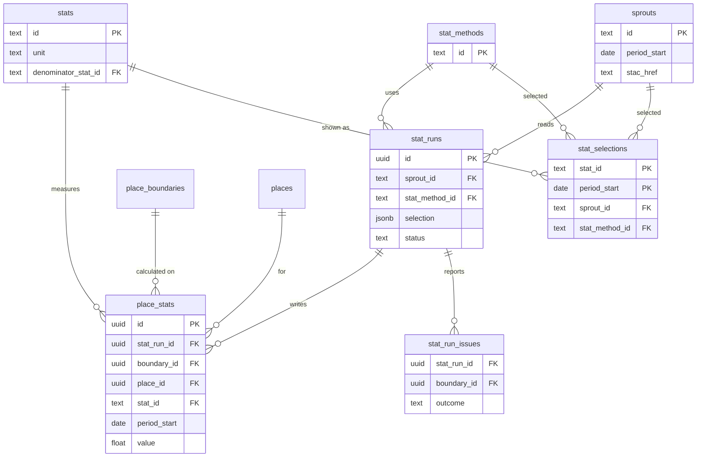
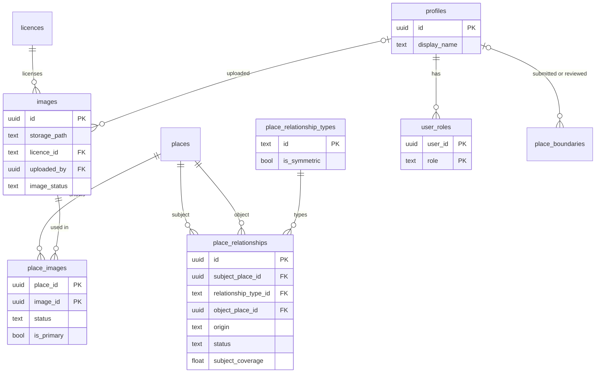

# Database design

The target design of the Sooty Earth database in Supabase (PostgreSQL with PostGIS). It came out of the [Database Honing](../parcels/database-honing.md) parcel. Why each choice was made is in [decisions.md](decisions.md).

**Status: proposed, partly in place.** When a stage lands, its section is marked *in place*. The working schema until then is described in [docs/blueprint.md](../blueprint.md) and [supabase/README.md](../../supabase/README.md).

## 1. What owns what

| System | Owns |
| --- | --- |
| **Database** | Places, boundaries and their versions, quality findings, Stats eligibility, relationships, publication state, application-facing Stats, sources and licences, images and their review, users and roles |
| **Cookbook** (analysis repo) | How a layer is made: seed and sprout paths, class values, resampling, tile settings |
| **STAC catalogue** | The inventory of raster assets beside each sprout |
| **Data Store, Tiles Store** | The raster and tile files |
| **PMTiles** | A display copy of boundaries. Never the source of truth. Every feature carries `places.id`. |

The database keeps only what it needs to point at a layer: the sprout id, which is also the recipe id and the STAC collection id, plus a title, a period, and a source. It does not copy recipes or STAC items.

## 2. Conceptual model

A **Place** is something on Earth with a name: a country, a national park, a World Heritage Site, an ecoregion, an old-growth forest. It has a stable id that never changes.

A Place has a **type**. Each type belongs to a **category**. Some categories add their own **details**, for example a conservation area's IUCN category.

A Place has one or more **boundaries**. Each boundary is a version with its own source. One boundary at most is current. Old boundaries are kept.

Each boundary has **quality checks**. A boundary can be visible and approved and still be kept out of Stats.

A Place can have **relationships** with other Places: a park is located in a country, a World Heritage Site recognises a park.

A **Stat** is a number calculated for one boundary version, from one sprout, with one method, for one period, in one run.

A **source** says where something came from: a dataset and its release, a paper, a platform such as Wikimedia Commons, or a contributor. Each record that needs provenance points at its source.

An **image** can be linked to many Places. Each link is reviewed on its own.

A **profile** is a signed-in person. Supabase Auth handles sign-in. A **role** says what a person may do.

## 3. Status fields

Different questions get different fields. No single `status` mixes them.

| Question | Field | On |
| --- | --- | --- |
| Can users see it? | `publication_status`: `draft`, `published`, `withdrawn`, `merged` | Place |
| Is this boundary accepted as true? | `review_status`: `proposed`, `approved`, `rejected`, `withdrawn` | Boundary |
| Which boundary is in use? | `is_current` | Boundary |
| Is the shape trustworthy? | `qc_status`: `unchecked`, `passed`, `flagged`, `accepted` | Boundary |
| May Stats use it? | `stats_eligibility`: `pending`, `eligible`, `excluded` | Boundary |
| Does it need attention? | Derived in an admin view. Not stored. | — |

An example: a Canadian protected area with over a hundred small parts is `published`. Its boundary is `approved` and current, `flagged` by the `small_components` check, and `pending` for Stats until an editor decides.

## 4. Tables

Types: `uuid`, `text`, `timestamptz`, `date`, `double precision`, `integer`, `boolean`, `jsonb`, `geometry(MultiPolygon, 4326)`. Every table has `created_at timestamptz not null default now()`. Tables whose rows change also have `updated_at`, set by the shared trigger `set_updated_at()`.

### 4.1 Places

*In place* for `place_categories`, `place_types`, `places.place_type_id`, `publication_status`, `merged_into_place_id`, `place_source_ids`, and `conservation_area_details` since task 04 (`20261112100000_types_and_details.sql`). Only the category and type `conservation_area` are stored. `places.submitted_by` and `place_source_ids.matched_by` come with `profiles` in task 10. `recognition_details` and `old_growth_details` come with their records. The WDPCA fields not yet imported (`protection_kind`, `designation_type`, `legal_status`, `status_year`, `governance_type`, `source_attributes`) stay null until the next import. A conservation area place is one WDPCA parcel (record 20). Task 05 merged the parcels of each multi-parcel site, and task 05a undid it (`unmerge_wdpa_site_parcels()`). A `proposed` `wdpa_site_id` row marks a site whose parcels a person has not yet decided to merge or keep apart. Since task 06 (`20261117100000_merge_wdpa_site.sql`) a person decides with `keep_wdpa_site_apart(site_id)` or `merge_wdpa_site(site_id, name)`. Both confirm the site row. On a site with several published places, a confirmed `wdpa_site_id` means a person kept them apart. `merge_wdpa_site` keeps the place holding the site row, gives it the union of the parcels as its next boundary version, and sets the others to `merged`. `place_merged_into(id)` returns the published place a merged place went to, so its old address still opens. The 74 sites were decided on 11 November 2026 (`20261117110000_wdpa_site_decisions.sql`). There is no unmerge function yet. Each merged parcel's superseded boundary keeps its SITE_PID. The importer's reconciliation report (record 4) is *in place* since task 05b (`supabase/import_wdpa.py reconcile`). The importer writes only when every record is `unchanged` or `reshaped`. Its writes for the other classes come with the first release or review that needs them.

**`place_categories`** — lookup.

| Column | Type | Notes |
| --- | --- | --- |
| `id` | text PK | `administration`, `conservation_area`, `old_growth`, `ecology`, `recognition` |
| `title` | text | |

**`place_types`** — lookup. A new type is one row.

| Column | Type | Notes |
| --- | --- | --- |
| `id` | text PK | e.g. `earth`, `continent`, `country`, `conservation_area`, `old_growth`, `ecoregion`, `world_heritage_site`, `ramsar_site` |
| `place_category_id` | text FK → `place_categories` | `on update cascade` |
| `details_kind` | text, null | Which details table applies: `conservation_area`, `recognition`, `old_growth`, or null |
| `title` | text | |

**`places`** — the existing table, with its ids kept.

| Column | Type | Notes |
| --- | --- | --- |
| `id` | uuid PK | Unchanged. PMTiles features carry it. |
| `name` | text | |
| `place_type_id` | text FK → `place_types` | `on update cascade` |
| `publication_status` | text | CHECK in `draft`, `published`, `withdrawn`, `merged` |
| `merged_into_place_id` | uuid FK → `places`, null | CHECK: set only when `merged`, and not equal to `id` |
| `submitted_by` | uuid FK → `profiles`, null | For contributor suggestions |

Indexes: `(place_type_id, publication_status)`. `pg_trgm` on `name` only when search is measured slow.

**`place_source_ids`** — a Place's ids in other datasets. It keeps identity stable across releases.

| Column | Type | Notes |
| --- | --- | --- |
| `id` | uuid PK | |
| `place_id` | uuid FK → `places` | |
| `source_id` | text FK → `sources` | The dataset, not the release |
| `id_kind` | text | e.g. `wdpa_site_pid` (the place), `wdpa_site_id` (its site) |
| `source_record_id` | text | |
| `match_status` | text | CHECK in `confirmed`, `proposed`, `retired` |
| `first_seen_release_id`, `last_seen_release_id` | uuid FK → `source_releases` | |
| `matched_by` | uuid FK → `profiles`, null | Null when the importer matched it |

Unique: `(source_id, id_kind, source_record_id) where match_status = 'confirmed'`. Index: `(place_id)`.

**`conservation_area_details`** — one row per conservation area.

| Column | Type | Notes |
| --- | --- | --- |
| `place_id` | uuid PK, FK → `places` | |
| `protection_kind` | text | CHECK in `protected_area`, `oecm`. From WDPCA `PA_DEF`. |
| `designation` | text | WDPCA `DESIG_ENG` |
| `designation_type` | text | CHECK in `national`, `regional`, `international`, `not_applicable` |
| `legal_status` | text | WDPCA `STATUS` |
| `status_year` | integer, null | |
| `iucn_category` | text, null | CHECK as today |
| `governance_type` | text, null | WDPCA `GOV_TYPE` |
| `iso3` | text[] | WDPCA lists several countries for some sites |
| `realm` | text | |
| `source_id`, `source_release_id` | | Provenance (see 4.3) |
| `source_attributes` | jsonb | The raw source row, unvalidated |

**`recognition_details`**: `place_id` PK, `scheme` (e.g. `world_heritage`, `ramsar`), `inscribed_on`, `criteria`, provenance columns.

**`old_growth_details`**: `place_id` PK, `delineation_method`, `assessed_on`, `methodology_version`, provenance columns. The source can be a publication.

A trigger on each details table checks that the place's type has the matching `details_kind`.

### 4.2 Boundaries and quality

*In place* for `place_boundaries` since task 05 (`20261113100000_place_boundaries.sql`, `20261113110000_boundaries_readers.sql`). Each place has one current, approved boundary: its parcel's geometry. Task 05 gave each site a version 1 boundary. Task 05a superseded the 74 site unions with each parcel's own shape, as version 2 on the kept place and version 1 on the others. `qc_status`, the `stats_eligibility` columns, `set_stats_eligibility`, `boundary_checks`, and `stats_eligible_boundaries` come with the parcel that resumes Stats, which is their first reader. Task 06 deferred them on 11 November 2026. `submitted_by`, `reviewed_by`, and `stats_eligibility_set_by` come with `profiles` in task 10. `approve_boundary` and `submit_boundary` come with the admin and contributor work. No separate `(place_id)` index: the version key and the unique current index both lead with `place_id`.

**`place_boundaries`**

| Column | Type | Notes |
| --- | --- | --- |
| `id` | uuid PK | New ids, never equal to a place id |
| `place_id` | uuid FK → `places` | |
| `version_number` | integer | Unique per place |
| `geom` | geometry(MultiPolygon, 4326) | Never granted to `anon` or `authenticated` |
| `area_km2` | double precision, generated | `st_area(geom::geography, true) / 1e6` |
| `bbox_west`, `bbox_south`, `bbox_east`, `bbox_north` | double precision | Filled by trigger, as today |
| `source_id`, `source_release_id`, `source_record_id`, `source_url` | | Provenance (see 4.3) |
| `derived_from_boundary_id` | uuid FK → `place_boundaries`, null | For a repaired or edited copy |
| `submitted_by` | uuid FK → `profiles`, null | |
| `review_status` | text | CHECK in `proposed`, `approved`, `rejected`, `withdrawn` |
| `reviewed_by` | uuid FK → `profiles`, null | `on delete set null` |
| `reviewed_at`, `review_note` | | |
| `is_current` | boolean | |
| `superseded_at` | timestamptz, null | |
| `qc_status` | text | CHECK in `unchecked`, `passed`, `flagged`, `accepted`. Default `unchecked`. |
| `stats_eligibility` | text | CHECK in `pending`, `eligible`, `excluded`. Default `pending`. |
| `stats_eligibility_reason`, `stats_eligibility_set_by`, `stats_eligibility_set_at` | | |

Constraints:

- `unique (place_id, version_number)`
- unique index `(place_id) where is_current`: at most one current boundary
- `check (not is_current or review_status = 'approved')`
- `check (review_status <> 'approved' or (st_isvalid(geom) and not st_isempty(geom)))`: only accepted boundaries must be valid. A proposed boundary may be invalid, so the problem can be recorded and repaired.
- `check (stats_eligibility <> 'eligible' or qc_status in ('passed', 'accepted'))`

Indexes: GiST on `geom`; `(place_id)`.

Intake accepts any non-empty polygonal geometry in EPSG:4326, made multi with `st_multi`. A repair never edits a row. It adds a new proposed version with `derived_from_boundary_id`.

The RPC `approve_boundary(boundary_id)` approves a boundary and makes it current in one transaction. It clears `is_current` on the previous boundary and sets `superseded_at`. It never changes `stats_eligibility`. A new current boundary starts `pending`.

**`boundary_checks`** — append-only findings.

| Column | Type | Notes |
| --- | --- | --- |
| `id` | uuid PK | |
| `boundary_id` | uuid FK → `place_boundaries` | |
| `check_id` | text | e.g. `geometry_valid`, `small_components`, `holes`, `vertex_count` |
| `check_category` | text | CHECK in `technical`, `modelling`, `processing_cost` |
| `outcome` | text | CHECK in `pass`, `warn`, `fail` |
| `measured_value` | double precision, null | |
| `threshold_used` | double precision, null | |
| `checker_version` | text | QC code version, or `manual` |
| `checked_by` | uuid FK → `profiles`, null | Null for automated checks |
| `details` | jsonb | |
| `checked_at` | timestamptz | |

Index: `(boundary_id, check_id, checked_at desc)`.

The four starting checks:

| Check | Category | Effect |
| --- | --- | --- |
| `geometry_valid`: valid, not empty, polygonal | technical | `fail` blocks approval |
| `small_components`: number of parts, and the share of parts below a size set per place type | modelling | `warn` sets `qc_status` to `flagged` |
| `holes`: number of interior rings, and the share of tiny holes | modelling | `warn` sets `flagged` |
| `vertex_count`: a stand-in for processing cost | processing_cost | Does not change `qc_status`. It informs `stats_eligibility` only. |

Thresholds are set per place type in the QC code, which is versioned. Each row records the threshold and version it used. A later check is a new `check_id`. No schema change is needed.

**`stats_eligible_boundaries`** — the only place the Stats Pipeline reads from.

```sql
create view stats_eligible_boundaries
with (security_invoker = true) as
select b.id as boundary_id, b.place_id, p.place_type_id, b.area_km2
from place_boundaries as b
join places as p on p.id = b.place_id
where b.is_current
  and b.stats_eligibility = 'eligible'
  and p.publication_status = 'published';
```

`is_current` implies approved and valid, through the constraints. Draft, withdrawn, and merged places are left out. A merged place's survivor has its own boundary. A run that needs draft places selects them explicitly and records that in its `selection`.

### 4.3 Sources and licences

*In place* for `licences`, `sources`, and `source_releases` since task 03 (`20261111100000_sources.sql`). The provenance columns come with the tables that carry them, in later tasks.

**`licences`**: `id` text PK (e.g. `cc-by-4.0`), `title`, `url`, `requires_attribution`, `share_alike`, `allows_commercial`.

**`sources`** — anything a record can come from.

| Column | Type | Notes |
| --- | --- | --- |
| `id` | text PK | e.g. `wdpca`, `glad-cropland`, `khan-2026`, `wikimedia-commons`, `inaturalist`, `sooty-earth-contributors` |
| `source_kind` | text | CHECK in `dataset`, `publication`, `platform`, `contributors` |
| `title`, `publisher`, `url` | text | |
| `doi`, `authors`, `published_year` | | For publications |
| `citation` | text, null | For sources without releases |
| `licence_id` | text FK → `licences`, null | Default licence |
| `described_by_source_id` | text FK → `sources`, null | A dataset's paper, e.g. GLAD cropland → Khan et al. 2026 |

**`source_releases`** — the existing `sources` table, renamed, with its ids kept. Only for sources that publish versions.

| Column | Type | Notes |
| --- | --- | --- |
| `id` | uuid PK | |
| `source_id` | text FK → `sources` | |
| `version_label` | text | e.g. `October 2026` |
| `released_on` | date | Was `release_month`. First of the month for WDPCA. |
| `accessed_on` | date, null | |
| `download_url`, `checksum` | text | As today |
| `citation` | text | WDPCA's citation names the month, so it lives here |

Unique: `(source_id, version_label)`, `(id, source_id)` for the composite foreign key.

**The provenance columns.** Every table that needs provenance has the same four columns:

| Column | Notes |
| --- | --- |
| `source_id` text not null, FK → `sources` | |
| `source_release_id` uuid null | Composite FK `(source_release_id, source_id)` → `source_releases (id, source_id)`, so a release always belongs to its source |
| `source_record_id` text null | SITE_ID, `File:…jpg`, an observation id |
| `source_url` text null | The record's own page |

Examples: a WDPCA boundary fills all four. A boundary from a paper has a publication source and no release. A Commons image has `wikimedia-commons` and its file name. A user upload has `sooty-earth-contributors` and `uploaded_by`.

### 4.4 Stats

*In place* since task 07 (`20261118100000_stats.sql`, `20261118110000_stats_backfill.sql`) for `stats`, `stat_methods`, `sprouts`, `stat_runs`, `place_stats`, `stat_selections`, and `place_stats_preferred`. The 941 cropland facts are 2,823 `place_stats` rows of one run, on each place's version 1 boundary. `place_stats` is append-only by grant: `service_role` can select and insert only. A trigger refuses a boundary of another place. `stat_run_issues` comes with the parcel that resumes Stats, its first writer. `stat_selections.selected_by` comes with `profiles` in task 10. `facts` stays until the frontend moves in task 08.

**`stats`** — what is measured.

| Column | Type | Notes |
| --- | --- | --- |
| `id` | text PK | e.g. `crops_area`, `crops_percent`, `valid_area`, `valid_coverage` |
| `title` | text | |
| `unit` | text | CHECK in `km2`, `percent`, `ratio`, `count`, … |
| `denominator_stat_id` | text FK → `stats`, null | The stat a percentage or ratio is of, when that stat is stored. No `valid_area` stat is stored, so `crops_percent` has none, and its description names the valid area. |
| `description` | text | |

**`stat_methods`** — `fact_methods`, renamed. `id` text PK with a version (`area-weighted-spheroid-v1`), `summary`.

**`sprouts`** — the layers Stats read.

| Column | Type | Notes |
| --- | --- | --- |
| `id` | text PK | The recipe id and STAC collection id, e.g. `cropland-2024-v2` |
| `title` | text | |
| `period_start`, `period_end` | date | |
| `stac_href` | text | |
| `source_id`, `source_release_id` | | Provenance |

**`stat_runs`**

| Column | Type | Notes |
| --- | --- | --- |
| `id` | uuid PK | |
| `sprout_id` | text FK → `sprouts` | |
| `stat_method_id` | text FK → `stat_methods` | |
| `selection` | jsonb | What the run chose: all eligible, some types, some ids, or missing only |
| `boundary_count` | integer | |
| `code_version` | text | Git commit |
| `batch_job_id` | text, null | |
| `status` | text | CHECK in `running`, `succeeded`, `partial`, `failed`, `retracted` |
| `retracted_reason` | text, null | Required when retracted |
| `started_at`, `finished_at` | timestamptz | |

Unique: `(id, sprout_id, stat_method_id)` for the composite foreign key below.

**`place_stats`** — append-only. Rows are never updated or overwritten.

| Column | Type | Notes |
| --- | --- | --- |
| `id` | uuid PK | |
| `stat_run_id` | uuid | |
| `sprout_id`, `stat_method_id` | text | Composite FK `(stat_run_id, sprout_id, stat_method_id)` → `stat_runs`, so they always match the run |
| `place_id` | uuid FK → `places` | |
| `boundary_id` | uuid FK → `place_boundaries` | |
| `stat_id` | text FK → `stats` | |
| `period_start`, `period_end` | date | |
| `value` | double precision | Full precision. Rounding is for display. |
| `calculated_at` | timestamptz | |

Unique: `(stat_run_id, boundary_id, stat_id, period_start)`. Index: `(stat_id, period_start, sprout_id, stat_method_id, boundary_id, calculated_at desc)`.

**`stat_run_issues`**: `stat_run_id`, `boundary_id`, `outcome` (`failed` or `skipped`), `reason`, `created_at`. Only problems are stored. Old rows can be pruned.

**`stat_selections`** — which version the app shows.

| Column | Type | Notes |
| --- | --- | --- |
| `stat_id` | text FK → `stats` | PK with `period_start` |
| `period_start` | date | |
| `sprout_id`, `stat_method_id` | text FKs | |
| `selected_by`, `selected_at` | | |

**`place_stats_preferred`** — the view the app reads. For each current boundary, stat, and period, it picks:

1. rows from the selected sprout and method, and no other. There is no fallback to an older sprout for places a new run missed, because mixing versions in one list misleads;
2. rows on the place's **current** boundary. After a boundary change the place shows "not calculated yet", and the old values stay in the table;
3. rows from runs that `succeeded` or were `partial`. Running, failed, and retracted runs are left out;
4. of those, the latest `calculated_at`. A rerun of ten places replaces only those ten.

```sql
create view place_stats_preferred
with (security_invoker = true) as
select distinct on (s.boundary_id, s.stat_id, s.period_start)
  s.place_id, s.boundary_id, s.stat_id, s.period_start, s.period_end,
  s.value, s.sprout_id, s.stat_method_id, s.stat_run_id, s.calculated_at
from place_stats as s
join stat_selections as sel
  on sel.stat_id = s.stat_id
  and sel.period_start = s.period_start
  and sel.sprout_id = s.sprout_id
  and sel.stat_method_id = s.stat_method_id
join stat_runs as r
  on r.id = s.stat_run_id and r.status in ('succeeded', 'partial')
join place_boundaries as b
  on b.id = s.boundary_id and b.is_current
order by s.boundary_id, s.stat_id, s.period_start, s.calculated_at desc;
```

Move the selection to a new sprout only once its run covers the eligible boundaries. Materialise this view only if a measured list query is too slow.

### 4.5 Relationships

**`place_relationship_types`**: `id` text PK, `label`, `inverse_label`, `is_symmetric`.

| `id` | Meaning | Symmetric |
| --- | --- | --- |
| `part_of` | An official administrative hierarchy: a province is part of a country | no |
| `located_in` | Lies wholly or partly within: a park in a country, a cross-border park in two countries | no |
| `recognises` | A recognition is about this place: a World Heritage Site recognises a park | no |
| `overlaps` | The boundaries meet, and a reviewer confirmed it matters | yes |

**`place_relationships`**

| Column | Type | Notes |
| --- | --- | --- |
| `id` | uuid PK | |
| `subject_place_id` | uuid FK → `places` | |
| `relationship_type_id` | text FK → `place_relationship_types` | |
| `object_place_id` | uuid FK → `places` | |
| `origin` | text | CHECK in `manual`, `imported`, `derived` |
| `status` | text | CHECK in `proposed`, `confirmed`, `rejected` |
| `subject_boundary_id`, `object_boundary_id` | uuid, null | For derived rows: the versions used |
| `subject_coverage` | double precision, null | Derived rows only: the share of the subject's area inside the object |
| `source_id`, `source_release_id` | | Provenance |
| `created_by`, `reviewed_by` | uuid FK → `profiles`, null | |
| `retired_at` | timestamptz, null | |

Constraints:

- `check (subject_place_id <> object_place_id)`
- `check (subject_coverage is null or origin = 'derived')`
- unique index `(subject_place_id, relationship_type_id, object_place_id) where retired_at is null`
- for symmetric types, a trigger requires `subject_place_id < object_place_id`, so "A overlaps B" and "B overlaps A" cannot both exist
- for asymmetric types, a trigger refuses the reverse of an active row

Examples:

| Subject | Type | Object | Shown on the object's profile |
| --- | --- | --- | --- |
| Kruger National Park | `located_in` | South Africa | contains Kruger National Park |
| Forest Massif of Odzala-Kokoua (WHS) | `recognises` | Odzala-Kokoua National Park | is recognised by the World Heritage Site |
| Sangha Trinational (WHS) | `recognises` | Lobéké, Dzanga-Sangha, Nouabalé-Ndoki | three rows. Each park shows the site. |
| A Ramsar site | `recognises` | A park it partly covers | is recognised by the Ramsar site |

**No relationship means stats can be added up.** Places in the same country can overlap or leave gaps. A total across places is its own calculation on a spatial union, or a stat of the parent's own boundary.

Spatial overlap is found on demand by an admin-only function using the GiST index. It is not stored. A reviewer's decision is stored: `confirmed` keeps the link, `rejected` stops it being suggested again.

### 4.6 People, images, audit

**`profiles`**: `id` uuid PK, FK → `auth.users` `on delete cascade`, `display_name`. References to a profile from review columns use `on delete set null`, so a deleted account leaves "former user".

**`user_roles`**: `user_id` FK → `profiles`, `role` CHECK in `contributor`, `editor`, `admin`. PK `(user_id, role)`. The helper `has_role(role text)` is `security definer` and `stable`.

Supabase Auth does all sign-in. There are no password, session, or identity tables of our own. `auth.identities` already maps sign-in providers to users.

**`images`**

| Column | Type | Notes |
| --- | --- | --- |
| `id` | uuid PK | |
| `storage_path` | text, null | Supabase Storage, for uploads and cached copies |
| `external_url` | text, null | CHECK: one of the two is set |
| provenance columns | | `source_id`, `source_release_id`, `source_record_id`, `source_url` |
| `creator_name`, `credit_text` | text | Who holds the rights, and how to credit them |
| `licence_id` | text FK → `licences` | |
| `uploaded_by` | uuid FK → `profiles`, null | Who added it. Null for pipelines. |
| `sha256` | text, unique | Stops the same file being stored twice |
| `width`, `height` | integer | |
| `image_status` | text | CHECK in `active`, `removed`. A removal applies everywhere. |

**`place_images`** — links an image to a Place. One image can link to many Places.

| Column | Type | Notes |
| --- | --- | --- |
| `place_id`, `image_id` | uuid | PK `(place_id, image_id)` |
| `status` | text | CHECK in `suggested`, `approved`, `rejected`, `withdrawn` |
| `suggested_by_user` | uuid FK → `profiles`, null | |
| `suggested_by_pipeline` | text, null | Pipeline name and version |
| `suggestion_score` | double precision, null | |
| `reviewed_by`, `reviewed_at`, `review_note` | | |
| `caption`, `alt_text` | text | |
| `is_primary` | boolean | Unique per place where true. CHECK: only when `approved`. |
| `gallery_position` | integer, null | |

`species_images` will have the same shape.

**`audit_log`**: `id` bigint identity, `table_name`, `row_id`, `action`, `actor` (from `auth.uid()`), `changed_at`, `old_values` jsonb, `new_values` jsonb. Filled by trigger on `places`, `place_boundaries` (without `geom`), `place_source_ids`, `place_relationships`, `place_images`, `user_roles`, `stat_selections`. Not on `place_stats` or `boundary_checks`, which are append-only already.

## 5. Diagrams

### Places and boundaries



### Sources



### Stats



### Relationships, images, people



## 6. Access and row-level security

| Who | Can |
| --- | --- |
| `anon` (visitors) | Read published places, their current boundary's attributes (never `geom`), details, relationships, approved images, sources, licences, stats definitions, and preferred stats |
| `authenticated` contributor | Everything a visitor can. Submit boundaries and images through RPCs. Read their own submissions. |
| editor, admin | Act through `security definer` RPCs that check `has_role()` |
| Pipelines | Their own login roles with only the grants they need: the importer writes places and boundaries, the Stats writer writes stats tables and reads eligible boundaries. Not `postgres`. |

Rules:

- **`geom` is never granted** to `anon` or `authenticated`. Grants on `place_boundaries` list the other columns. Map shapes come from PMTiles. `place_bounds` reads the bbox columns.
- **Every table**: enable RLS, `revoke all … from public, anon, authenticated`, then grant what is needed. Supabase grants new objects in `public` to `anon` and `authenticated` by default.
- **Every function**: `revoke execute … from public`, then grant to the roles that need it. Postgres grants new functions to `public`.
- **Privileged RPCs** (`approve_boundary`, `set_stats_eligibility`, `confirm_source_match`, `review_overlap`, `review_place_image`, `submit_boundary`): `security definer`, `set search_path = ''`, check `has_role()` inside, execute granted to `authenticated` only.
- **Views** use `security_invoker = true`. Supabase's linter flags views that run as their owner. The tables under each view need their own public policy.
- **Policies** wrap `auth.uid()` as `(select auth.uid())` so it runs once per query. Columns used in policies are indexed.

Public read policies:

| Table | `select` using |
| --- | --- |
| `places` | `publication_status = 'published'` |
| `place_boundaries` | `is_current and exists (select 1 from places p where p.id = place_id and p.publication_status = 'published')`. Check with `explain analyze` on the list query. |
| details tables, `place_relationships` | the place is published, and for relationships `status = 'confirmed'` |
| `place_images`, `images` | `status = 'approved'` and `image_status = 'active'` |
| `sources`, `source_releases`, `licences`, `place_types`, `place_categories`, `stats`, `stat_methods`, `sprouts`, `stat_runs`, `stat_selections`, `place_stats` | `true` |

Contributors submit boundaries through `submit_boundary(place_id, geojson)`, not a table insert. PostGIS does not read GeoJSON on insert. The RPC limits size, runs the technical check, and returns only an id.

### Frontend calls today and their targets

| Call in `places/api.ts` | Target |
| --- | --- |
| `from('protected_areas')` | `place_summaries` view: places with their current boundary's `area_km2` and bbox, details, and release |
| `from('facts')` | `place_stats_preferred` |
| `rpc('protected_area_window')`, `protected_area_rank`, `protected_area_filter_stats` | `place_window`, `place_rank`, `place_filter_stats`, with a place type parameter |
| `rpc('place_bounds')` | `place_bounds`, reading the current boundary's bbox |

*In place* since task 05b (`20261116100000_generic_place_reads.sql`) for `place_summaries`, `place_window`, `place_rank`, `place_filter_stats`, and `place_bounds`, together with `place_window_count`, `place_kept_ids`, `place_matched`, and `places_in_extent`. `listed_places` holds the conservation area list rule (terrestrial, at least 10 km²). `place_crops_percent` reads `place_stats_preferred` for `crops_percent` since task 07, so no sprout or method id is written in SQL. The old names stay only as wrappers until the frontend moves in task 08, then they are dropped.

## 7. Naming

| Item | Rule | Example |
| --- | --- | --- |
| Table | plural, snake_case | `places`, `place_boundaries` |
| Association table | both names, plural last | `place_images` |
| Lookup table | plural, text id | `place_types.id = 'ramsar_site'` |
| Primary key | `id` | |
| Foreign key | singular table name + `_id` | `place_id`, `stat_run_id` |
| Timestamp | `_at`, timestamptz | `created_at`, `reviewed_at` |
| Date | `_on`, date | `released_on` |
| Status | text with CHECK, named for its question | `review_status`, `stats_eligibility` |
| Boolean | `is_` | `is_current` |
| Version | `-vN` in a text id, or `version_number` | `area-weighted-spheroid-v1` |
| Unique constraint | `<table>_<columns>_key` | `place_boundaries_place_id_version_number_key` |
| Check constraint | `<table>_<rule>_check` | |
| Index | `<table>_<columns>_idx` | `place_boundaries_geom_idx` |
| Function | verb or noun, snake_case | `approve_boundary`, `place_window` |

Words: **Places** for geographic things. **Stats** for calculated numbers. **Facts** is kept for future historical and descriptive information. **Cookbook** for processing recipes. Short forms: **crops** for cropland in new database ids, **old_growth**. Recipe and sprout ids keep their Cookbook names, such as `cropland-2024-v2`.

Text with CHECK is used instead of Postgres enums, because CHECK values can be changed in one migration.

## 8. Scale

At 50,000 places, about 10 stats, and 20 periods, `place_stats` holds about 10 million current rows. Ordinary B-tree indexes handle that. There is no partitioning, and no materialised view, until a real query is measured too slow. The import and the geometry copy use committed batches, never one long transaction.
